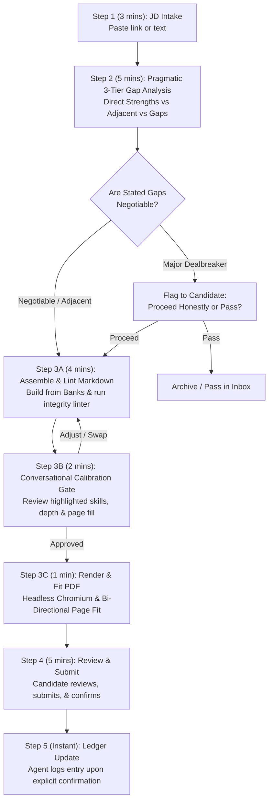

# 🧭 Operational Career Workflow & Execution Doctrine

> **Core Philosophy**: Low friction, explicit confirmation gates, immutable submitted artifacts, bank-first factual integrity, and ADHD-friendly micro-stepping to prevent overwhelm, eliminate procrastination, and maintain steady momentum.

---

## 🔒 Rule 1: Explicit Action Confirmation Gate

> [!IMPORTANT]
> The AI assistant will **never** mark an application as `Applied`, log an outreach as sent, or advance a pipeline status in [`applications/ledger.json`](../applications/ledger.json) based solely on preparing materials.
> 
> Status changes only occur when the candidate explicitly confirms:
> *"I have submitted the application"* or *"I sent the message to [Contact]"*.

---

## 📜 Rule 2: Immutable Submitted Application Resumes

> [!IMPORTANT]
> Once an application moves to **`Applied`** status:
> - The submitted resume files (`[Candidate]_Resume_[Company]_[ReqID].md` and `.pdf`) are **frozen as permanent historical artifacts** representing exactly what was submitted to that employer.
> - They will **never be overwritten in place** when updating master templates or other materials.
> - If an application requires a revised resume for a later interview round or recruiter request, it must be created as a new versioned file: `[Candidate]_Resume_[Company]_[ReqID]_v2.md` and `.pdf`.

---

## 🛡️ Rule 3: The Bank-First Whitelist & Depth Calibration (Zero Hallucination & Zero Embellishment)

> [!CAUTION]
> **Bank-First Factual Integrity Mandate**:
> The candidate's Comprehensive Career Banks—[`resumes/career_profile_bank.md`](../resumes/career_profile_bank.md) (categorized skills, education, certifications, and references) and [`resumes/modular_reserve_bank.md`](../resumes/modular_reserve_bank.md) (complete chronological employment history and bullets)—constitute an **immutable factual ceiling**.
> - **Master Resume Role**: `resumes/[Name]_Resume_Master.md` is not a raw data store; it is the **un-tailored general summary view** synthesized from the Career Banks.
> - **Tailoring is strictly defined as assembling, filtering, re-ordering, and prioritizing existing, verified achievements from the Career Banks.**
> - **Zero Infiltration**: The assistant must **NEVER** back-fill keywords, tools, certifications, or methodologies from a job description into the candidate's resume if they do not exist in the Career Banks.
> - **Never tag languages/tools with unverified qualifiers** like "(Familiar)" or "(Proficient)" to appease ATS keyword counters.
> - **Education & Credentials**: Never invent degrees, universities, or unverified certifications.

### 🎯 Calibrating Experience Depth ("Vibe Coded / Tool-Authored" vs. Direct Hands-On Mastery)
In the era of agentic AI workflows, professionals across **every industry** (software, healthcare, finance, marketing, operations, legal) frequently orchestrate autonomous AI agents to build tools, automate data pipelines, author complex formulas, or generate code they do not write by hand.

ACE enforces honest depth calibration across all professions to prevent embarrassing interview traps:

| Depth Level | Cross-Industry Definition | Technical / Software Example | Business, Ops, Finance & Healthcare Example | Proper Representation on Resume |
| :--- | :--- | :--- | :--- | :--- |
| **Level 1: Core / Direct Mastery** | Methodologies, core tools, and domain skills you execute directly from first principles; comfortable defending calculations, clinical protocols, architectural choices, or code without AI assistance. | Python, Go, distributed systems, PostgreSQL, live debugging. | Financial modeling, P&L management, GAAP/SOX compliance, clinical trial protocol design, supply chain forecasting. | Foregrounded in primary "Core Competencies" section; highlighted with active, direct verbs (*"Designed...", "Administered...", "Analyzed...", "Audited..."*). |
| **Level 2: AI-Assisted / Agentic Orchestration ("Tool-Authored / Vibe Coded")** | Solutions where you defined requirements, business logic, and architecture, but leveraged AI coding agents to author the scripts, apps, dashboards, or automations without deep language/code-level fluency. | Directing AI agents to build a Rust microservice or React interface without writing the syntax yourself. | Directing AI agents to write Python/SQL automation scripts, PowerBI DAX models, or custom clinical intake forms without being a full-time programmer. | **Framed around operational problem-solving, system design, and AI-accelerated delivery velocity** (*"Architected automated reconciliation pipeline via AI-scripted Python tools..."* or *"Orchestrated agentic workflows to build real-time inventory dashboard..."*). **Never** falsely claim raw programming/syntax mastery. |
| **Level 3: Incidental Exposure / Evaluated** | Platforms, secondary libraries, or sub-tools touched transiently during a project or collaboration. | Docker, Redis, third-party APIs. | Salesforce, Workday, Epic Systems, Google Analytics. | Kept in `resumes/career_profile_bank.md` and `resumes/modular_reserve_bank.md`; **never** foregrounded on tailored resumes unless explicitly requested, and even then, qualified as supporting integration. |

---

## 🛑 Rule 4: Zero Generational Drift (Strict Clean-Room Assembly)

> [!CAUTION]
> **The Anti-Slop Directive**:
> Every tailored resume MUST be generated as a fresh, clean-room build from the candidate's Career Banks (`resumes/career_profile_bank.md` and `resumes/modular_reserve_bank.md`, using `resumes/[Name]_Resume_Master.md` as the clean baseline layout).
> 
> - **Prohibition on Sequential Iteration**: The assistant must **NEVER** inspect, duplicate, copy, or iterate off a previously tailored resume (`applications/YYYY-MM-DD_*/*.md`) when preparing a new application.
> - **Why this causes template slop**: When an AI agent iterates off an already-tailored document, formatting standards shift, bullet verbs soften, metrics degrade, and passive voice creeps in, causing compounding linguistic drift ("telephone game slop").
> - **Immutable Baseline**: Every new application dossier starts from the pristine baseline and Career Banks. Tailoring consists strictly of:
>   1. Selecting and ordering the highest-relevance bullets from `resumes/modular_reserve_bank.md`.
>   2. Selecting and ordering matching verified skills and credentials from `resumes/career_profile_bank.md` (stripping `[Level 1/2/3]` tags per Rule 3).
>   3. Tuning the Professional Summary to foreground relevant Level 1 / Level 2 competencies.
>   4. Calibrating bullet count and density so the document neatly fills the target page count (Rule 6)—neither overflowing nor leaving awkward blank space.

### 💎 Ground Truth Quality: Auditing Your Career Banks
If tailored resumes feel generic or lack punch, the root cause is almost always an under-quantified Career Bank. Use the **`career-ingestion`** skill (`.agents/skills/career-ingestion/SKILL.md`) to continuously enrich your banks against these 4 standards:
1. **The XYZ Metric Formula**: Ensure >80% of bullets follow Google's XYZ formula:
   $$\text{Accomplished } [X] \text{, as measured by } [Y] \text{, by doing } [Z]$$
   *(e.g. "Reduced clinical intake latency by 42% (saving $180k annually) by architecting an automated validation pipeline across 14 clinic sites.")*
2. **High-Water Mark Metrics**: Include your verified high-water marks (P&L dollar amounts, headcount, user scale, percentage gains, latency cut, SLA reliability).
3. **Distinct Functional Anchors**: Ensure each role in `modular_reserve_bank.md` has a rich set of core leadership, execution, and technical/methodological bullets so tailored resumes can be expanded or focused effortlessly.
4. **Active Verbs Only**: Eliminate passive fluff ("Responsible for", "Helped with", "Participated in"). Replace with decisive verbs ("Spearheaded", "Architected", "Engineered", "Negotiated", "Orchestrated").

---

## ⚡ Rule 5: Atomic State & Dashboard Synchronization Protocol (Mandatory Pre-Condition)

> [!IMPORTANT]
> **Zero State Drift & Anti-Attention Bias**:
> LLMs naturally exhibit an "attention bias" toward generative and drafting tasks, frequently leaping ahead to analyze new roles or author outreach messages while neglecting to log real-world pipeline milestones.
> 
> To prevent pipeline desynchronization:
> - Whenever the candidate mentions or confirms a real-world pipeline milestone (*"I submitted to [Company]"*, *"I messaged [Contact]"*, *"Screen scheduled"*, *"Rejected"*), the assistant **MUST IMMEDIATELY** record the event in [`applications/ledger.json`](../applications/ledger.json) and synchronize [`DASHBOARD.md`](../DASHBOARD.md) as the **first action** before or alongside addressing any new request.
> - Run [`scripts/sync_pipeline.ps1`](../scripts/sync_pipeline.ps1) to mechanically verify 100% lockstep parity between the ledger database and the markdown dashboard.

---

## ⚡ The 20-Minute Micro-Stepped Application SOP

To avoid executive paralysis and perfectionism loops, every application follows a structured 5-step micro-routine:

### Step-by-Step Breakdown:

#### 1. Step 1: Intake (3 mins)
- Candidate pastes a job posting URL or requisition text into the assistant chat (or pulls a verified lead from [`applications/sourcing_inbox.md`](../applications/sourcing_inbox.md)).
- **Direct Requisition URL Check (Rule 8)**: Assistant ensures the opportunity URL points directly to the specific requisition (containing numeric Job ID or UUID) rather than a generic career portal root, ensuring 1-click access to the job description and application form.

#### 2. Step 2: Pragmatic 3-Tier Gap Analysis (5 mins)
The assistant reviews the JD against the candidate's Career Banks (`career_profile_bank.md` and `modular_reserve_bank.md`) and compensation floor. It produces an explicit 3-Tier match breakdown:
- **Tier 1 (Direct Strengths)**: 1:1 verified skills, metrics, and domain scope to foreground prominently.
- **Tier 2 (Transferable / Adjacent)**: Problem domains solved with verified tools, framed around the core functional challenge (never falsely rebranded as the missing tool).
- **Tier 3 (Notable Gaps / Check Negotiability)**: Requirements listed in the JD that are not in the candidate's background.
  > [!NOTE]
  > **Pragmatic Real-World Calibration**: Stated requirements in job descriptions are frequently aspirational wishlists rather than rigid disqualifiers. The assistant flags these gaps clearly so the candidate can evaluate them honestly, without hastily discarding roles where strong Tier 1/2 strengths make the candidate competitive.
- Check if warm 1st-degree contacts exist in [`network/contacts_ledger.md`](../network/contacts_ledger.md).

#### 3. Step 3: Assembly, Conversational Review Gate & Bi-Directional PDF Fitting (7 mins)
- **3A. Tailored Markdown Assembly & Integrity Lint Gate (4 mins)**:
  - Assistant creates the dossier folder: `applications/YYYY-MM-DD_[company]_[reqid]/` (falling back to `_[role_slug]/` if ReqID is absent, or appending `_2` on collision) via `powershell -File scripts/init_dossier.ps1 -Company "..." -Role "..." -RequisitionId "..." -Url "..." -PostingCompensation "..." -RegisterInLedger`.
  - **Clean-Room Assembly from Banks (Rule 4)**: Assistant selects the highest-relevance bullets from `resumes/modular_reserve_bank.md` and matching skills/credentials from `resumes/career_profile_bank.md` (using `resumes/[Candidate]_Resume_Master.md` as the clean structural scaffold). *Never copy or iterate off a past application dossier.*
  - **Bi-Directional Page-Fill Calibration (Rule 6)**: Ensure enough relevant bullets and competency lines are included from the banks so the resume neatly fills the target page count (`resume_settings.target_pages`, default `1`)—avoiding both page overflow and sparse, top-heavy whitespace.
  - Generates tailored resume: `[Candidate]_Resume_[Company]_[ReqID].md`.
  - **Mandatory Integrity Linter Pre-Condition**: Run the integrity linter:
    `powershell -File scripts/lint_resume_integrity.ps1 -TailoredResumePath ...`
    The linter **MUST pass with 0 errors** before proceeding to PDF compilation.
  - Generates [`application_form_guide.md`](../applications/dossier_template/application_form_guide.md) to pre-fill ATS portal questions (including calibrated Field 9 salary recommendations and any requested references from `resumes/career_profile_bank.md`).
- **3B. Conversational Calibration Gate (2 mins)**:
  Before launching browser PDF rendering, the assistant presents a 3-point check in chat:
  1. *Foregrounded Skills & Depth Check*: Confirms top highlighted skills are Level 1 (Hands-on Mastery) that the candidate is confident defending in technical screens.
  2. *Vibe-Coded / AI-Assisted Disclosures*: Flags any Level 2 technologies used in the draft, confirming they are framed around architecture/orchestration rather than language syntax.
  3. *Page Fill Check*: Confirms bullet count and density are calibrated to neatly fill the target page count (`1` page default).
  *Candidate confirms ("Approved, render PDF") or requests a bullet swap from the Reserve Bank.*
- **3C. PDF Compilation & Bi-Directional Page Verification (1 min)**:
  - **Pre-Condition Gate**: Verify that the Step 3A integrity linter passed with 0 errors and candidate confirmed Step 3B calibration.
  - Compiles PDF with bi-directional auto-fit (`Tight`/`Compact` for dense content, `Standard` for balanced content, `Comfortable`/`Spacious` for lighter content):
    `powershell -File scripts/render_resume.ps1 -MarkdownPath ...`
  - Validates target page count:
    `powershell -File scripts/check_pdf_pages.ps1 -Path ...`
  - If `render_resume.ps1` or `check_pdf_pages.ps1` reports `OVERFLOW`, demote 1-2 less relevant bullets. If it reports `SPARSE CONTENT` or `UNDERFLOW`, pull additional verified bullets or skills from `resumes/modular_reserve_bank.md` and `resumes/career_profile_bank.md` and re-render.

#### 4. Step 4: Submission & Explicit Confirmation (5 mins)
- Candidate reviews, opens the application link, submits, and messages the assistant: *"Submitted"*.

#### 5. Step 5: Atomic Ledger & Dashboard Synchronization (Instant)
- Enforcing **Rule 5**, the assistant immediately records the submission in [`applications/ledger.json`](../applications/ledger.json), updates [`DASHBOARD.md`](../DASHBOARD.md), and freezes the resume artifacts.
- Runs `powershell -File scripts/sync_pipeline.ps1 -Company "..." -Role "..." -Status "applied" -GraduateFromInbox -UpdateDashboard` (or `-AppId "..." -Status "applied" -UpdateDashboard`) to validate schema integrity, graduate the lead from the sourcing inbox, deterministically regenerate funnel counts and table rows in `DASHBOARD.md`, and audit 100% lockstep parity.

---

## 📞 Post-Submission Protocol: Recruiter Screen & Compensation Calibration

Once an application advances from `Applied` to initial recruiter outreach:

1. **Atomic State Advance**: When the candidate confirms a scheduled screen, the assistant updates `applications/ledger.json` (`status: "screen_scheduled"`) and synchronizes `DASHBOARD.md` immediately per Rule 5.
2. **Interview Prep Generation**: Prepare `applications/YYYY-MM-DD_[company]_[reqid]/interview_prep.md` tailored with company priorities, STAR stories, and strategic reverse questions.
3. **The "Deflect & Solicit" Compensation Sequence**:
   - In the initial recruiter screen, recruiters frequently probe for salary expectations to verify budget alignment.
   - **Protocol**: Solicit the employer's approved band first (*"Given that [Company] has established bands for this role and level, what is the budgeted target salary range?"*).
   - If required to anchor first, quote your calibrated target range (*"$[Target Min] to $[Target Max] base plus equity"*), emphasizing that total package and mission alignment provide flexibility.
   - See [`workflows/compensation_estimator.md`](compensation_estimator.md) and [`applications/dossier_template/interview_prep.md`](../applications/dossier_template/interview_prep.md) for full verbal scripts.

---

## ⏰ Sustainable Energy & Time Budgeting

To maintain steady momentum and avoid job search burnout:

| Time Slot | Daily Allocation | Weekly Total | Primary Focus |
| :--- | :--- | :--- | :--- |
| **Morning Focus Block** | 1.5 - 2.0 hrs / day | ~8-10 hrs / wk | **Active Pipeline**: Intake, 20-min tailoring, warm referrals, follow-up messages. |
| **Midday / Afternoon Block** | 2.0 - 2.5 hrs / day | ~10-12 hrs / wk | **Skills & Professional R&D**: Projects, certifications, mock interview practice, portfolio building. |
| **Rest & Recovery Window** | Evenings & Weekends | Protected | Recharge, physical wellness, family, avoiding late-night doom-scrolling of job boards. |

---

## 📈 Weekly Retrospective & Pipeline Health Cadence

At the end of each week (e.g. Friday afternoon):
1. **Pipeline Count**: Review active applications in `applications/ledger.json`.
2. **Aging Alarms**: Flag applications submitted $\ge 14$ days ago without response:
   - Schedule polite follow-up outreach via [`network/outreach_templates.md`](../network/outreach_templates.md), or move to `Archived` to keep the pipeline clean.
3. **Weekly Goal Check**: Verify whether target weekly submission velocity (e.g. 2-4 high-quality tailored applications) was met.
